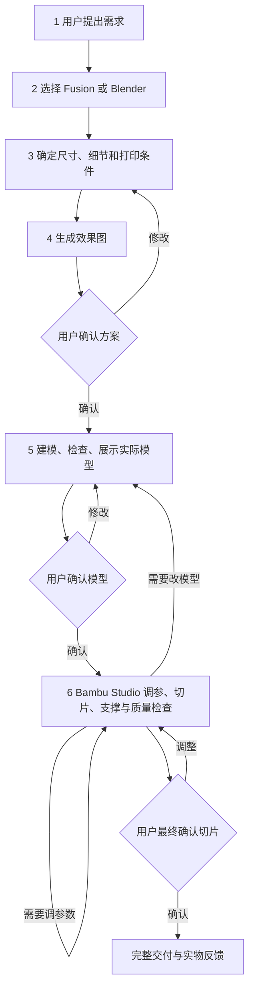

# 3D 打印工作流 · print-workflow

从需求到切片交付的中文 Codex 技能，按用户确认的六步流程组织，保留 **效果图方案、实际模型、最终切片** 三次确认。

建模使用 **Fusion 360 / Blender**，主切片软件为 **Bambu Studio**。本仓库包含技能指令、逐步注解、状态和检查脚本、模板及测试。脚本面向 Windows；其他平台未验证。



## 从哪里读

- [技能入口 SKILL.md](SKILL.md)：执行规则，每一步有中文注解。
- [完整流程注解](references/workflow-notes.md)：输入、操作、输出、确认与回退条件。
- [安装和本机操作](references/local-operations.md)：配置、调用和测试。
- [检查模板](scripts/templates/切片审查.md)：支撑拆除、首层、桥接、稳定性和翘边。

## 安装

把完整 `print-workflow` 文件夹复制到你的 Codex 技能目录，保留内部结构。然后在 Windows PowerShell 7 中执行：

```powershell
# 进入安装后的 print-workflow 目录，Python 需为可用的 3.11+ 解释器。
& .\scripts\setup.ps1 -PythonExecutable 'C:\实际路径\python.exe'
```

编辑生成的 `scripts/config.json`，填写本机软件路径与模型保存目录。脚本不会安装 Fusion、Blender、Bambu Studio 或它们的 MCP 插件。打开新聊天后可调用 `$print-workflow`，例如“按我的完整工作流制作一个收纳盒”。

## 验证范围

仓库测试使用临时合成数据，验证阶段门禁、文件变化失效、网格基础检查、3MF 解析与打包；不需要实际打印机。作者本机原始部署曾验证 Fusion/Blender MCP、Bambu Studio 02.08.04.57 的 STL 切片和配置工程再切片；移植到另一台电脑仍须重新验证。具体见 [验证说明](references/validation.md)。

本技能不会自动上传或启动打印。成功切片不等于物理打印和装配已通过。
